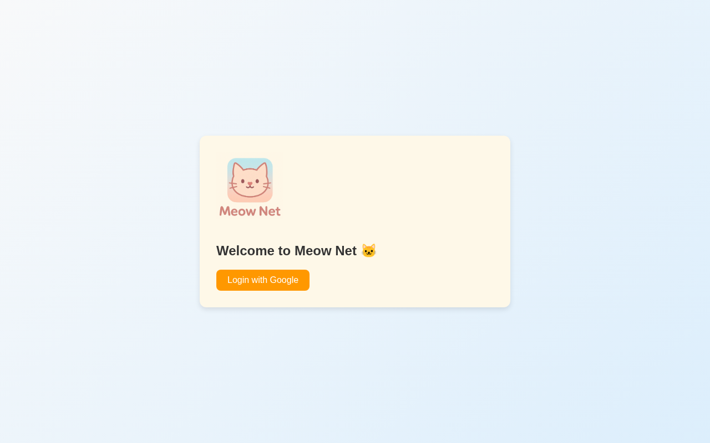
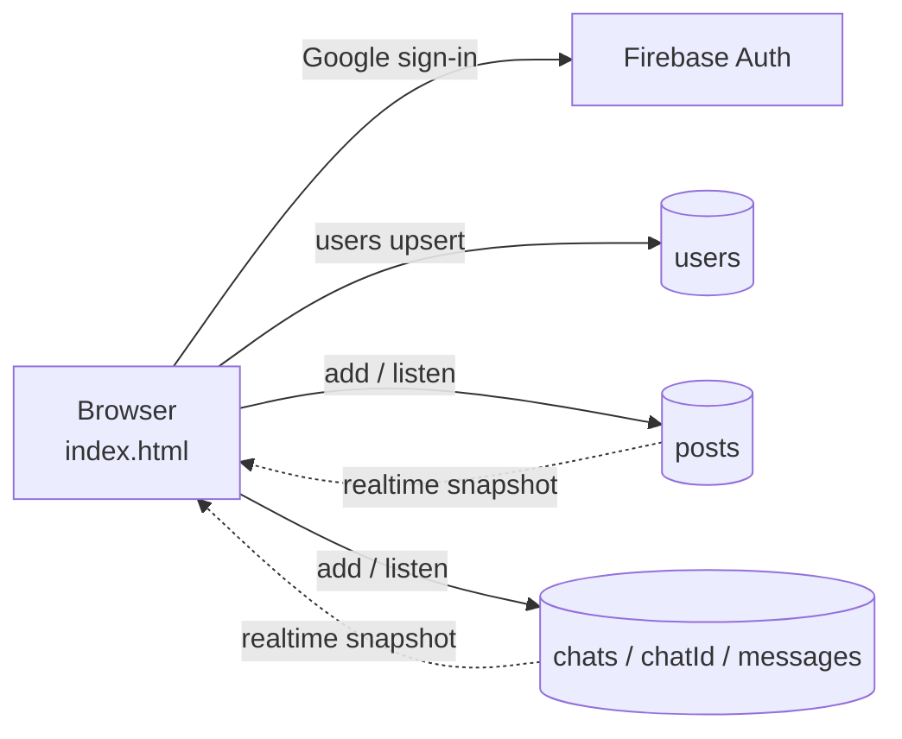

# Meow Net 🐱 — A Cat-Themed Social Feed & Chat

> A small real-time social app: sign in with Google, post to a shared feed, like posts, and chat one-to-one — built as a single-page static site on **Firebase Authentication + Cloud Firestore**.


**Live demo:** <https://ppro916.github.io/Meow-Net/> (sign-in with a Google account required)



> Only the login screen is pictured: the feed and chat sit behind Google sign-in, so I have not added mock screenshots of them.

## Features

- **Google sign-in / sign-out** via Firebase Authentication.
- **Meow Feed** — create text posts that appear for everyone in real time (newest first).
- **Likes** — one like per user per post (tracked with `likedBy` + an atomic counter increment).
- **User directory** — "See All Users" lists the other signed-in users.
- **One-to-one chat** — real-time Firestore chat; each pair of users shares a deterministic chat id built from the sorted user ids.
- **Output escaping** — posts and chat messages are HTML-escaped before rendering.
- Cat-themed UI with a logo and background art; the repo also contains `send-meow.mp3` / `receive-purr.mp3` sound files, used only by the earlier prototype `2index.html`.

## Tech stack

| Layer | Tools |
| --- | --- |
| Front end | Vanilla HTML / CSS / JavaScript (single `index.html`) |
| Auth | Firebase Authentication (Google provider), Firebase JS SDK 8.10 (CDN) |
| Database | Cloud Firestore (collections: `users`, `posts`, `chats/{id}/messages`) |
| Hosting | GitHub Pages (static) |

## Architecture



## Getting started

No build step — it is a static site.

```bash
git clone https://github.com/ppro916/Meow-Net.git
cd Meow-Net
python3 -m http.server 8000      # then open http://localhost:8000
```

Google sign-in only works from domains listed under **Firebase Console → Authentication → Settings → Authorized domains** (`localhost` is included by default).

### Use your own Firebase project

1. Create a Firebase project, enable **Authentication → Google** and **Cloud Firestore**.
2. Replace the `firebaseConfig` object in `index.html` with your web-app config.
3. Add your hosting domain to Authorized domains and write Firestore security rules (see below).

## Configuration & security notes

- The Firebase **web config** (`apiKey`, `projectId`, …) in the source is public by design — it identifies the project, it is not a secret. **Access control is enforced by Firestore Security Rules**, so make sure the rules restrict reads/writes to signed-in users and to a user's own documents.
- The app stores each user's display name and email in the `users` collection so people can find each other; treat that as personal data when writing rules.
- No `.env` is needed.

## Repository notes

`index.html` is the live app. `2index.html`, `no chat index.html`, `dummy-test.html`, `app.js`, `firebase-config.js` and `text` are earlier prototypes / scratch files kept for history.

## Roadmap

- [ ] Tighten and document Firestore security rules in the repo
- [ ] Split `index.html` into HTML / CSS / JS modules
- [ ] Upgrade to the modular Firebase v10+ SDK
- [ ] Message timestamps and unread indicators
- [ ] Remove the unused prototype files

## Author

**Moreshwar Bhonde** — AI & Data Science engineering student, AI-first developer, founder of AI Nexus × Neon AI Studio.

- GitHub: [@ppro916](https://github.com/ppro916)
- Website: [neonaistudio.in](https://neonaistudio.in)

## License

[MIT](LICENSE)
